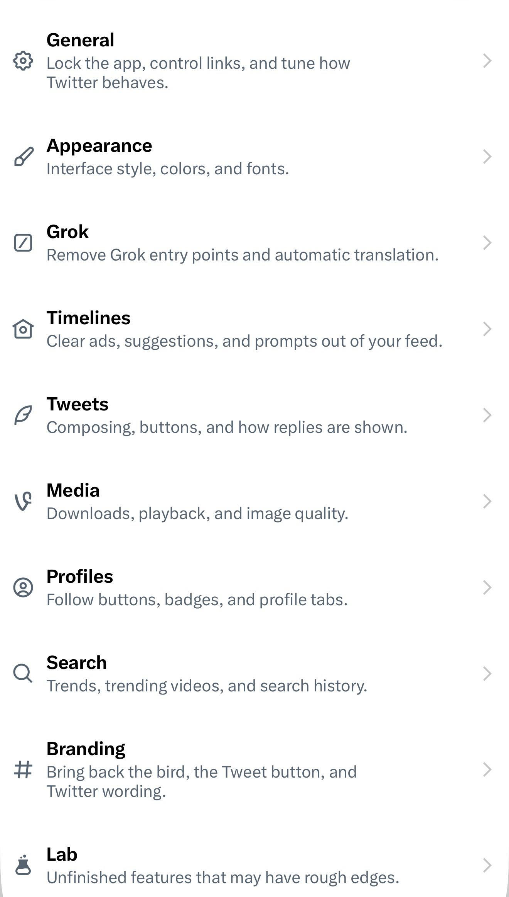
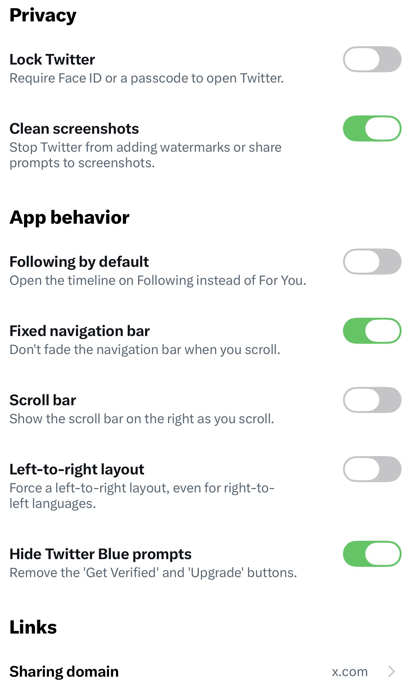
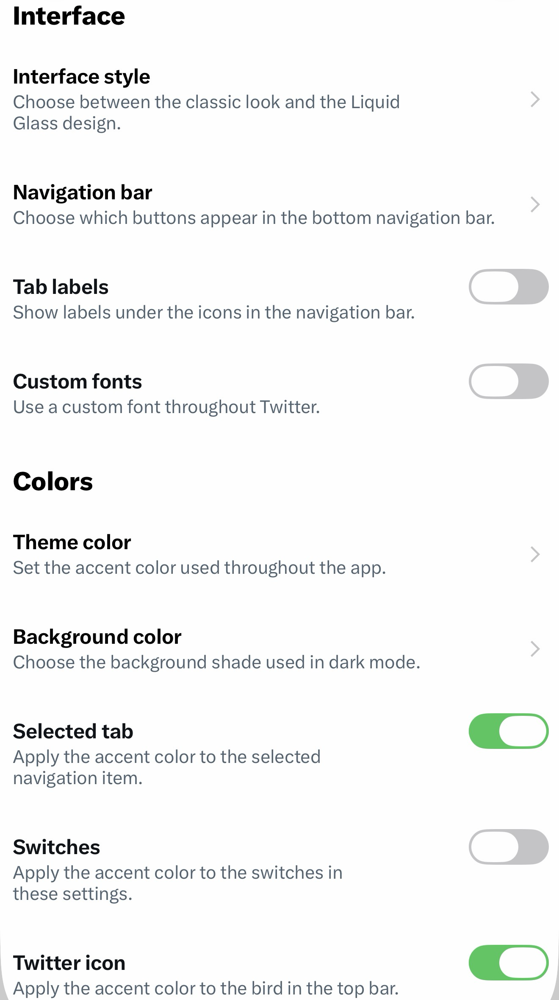

    

  # PrimeFreeBird
  <i>A Twitter/X tweak.</i>

 

| | | |
|:-------------------------:|:-------------------------:|:-------------------------:|
||||

# Features

## Liquid Glass

- **Liquid Glass, enabled** — the stock app opts out of iOS 26's redesign; this switches it back on, or keeps the flat look.
- **No blurred edge** — the redesign makes iOS draw a strip under every bar; a switch puts the stock look back.
- **Bar icons that match** — the settings gear, the search filters and the muted-words icon take the color of Twitter's own bar icons and keep it.

## Color theme

- **Any color you want** — a *Custom* swatch beside the six preset colors opens the native iOS picker.
- **Applied everywhere** — the bird, links, @mentions, #hashtags and buttons follow it, and the settings switches too with *Switches* on.
- **Dark shades** — choose System, Dim, Gray or Blackout, and every surface follows: sheets, cells, the search field and the bars.

## Explore &amp; search

- **Per-tab control** — hide any of Explore, Trending, News, Sports or Entertainment, rather than the whole page.
- **Advanced search** — the web's full search form (words, accounts, engagement, dates), native, with results in Twitter's own search.

## Filters

- **One list for everything** — a word, a phrase or an @account; the type is recognized from what you type.
- **Filter by language** — keep only the languages you read; Tweets with no detected language always pass.
- **Quick access from the feed** — an icon in the timeline's top bar adds or removes a filter without leaving your scroll.
- **Filters that expire** — give a word 24 hours, 7 days or 30 days, or keep it for good.
- **Precise by default** — whole-word matching, so "cat" never catches "concatenate".
- **Scope you decide** — filter replies inside conversations too, spare the people you follow, and choose whether Retweets count.
- **A quiet tally** — the page keeps a small count of what it filtered out today.

## Timeline

- **Unlimited timeline tabs** — pin far more lists and topics than Twitter allows, and unlock advanced tabs like Ranked Following.
- **Reading marker** — marks where you were when new Tweets arrive above, on Following.
- **Hide topics** — topic Tweets and the "Topics to follow" carousel both go.
- **Remember Home tab** — Home stays on the tab you last picked instead of going back to For You after 12 hours.
- **Preload media** — images and videos are ready the moment you scroll to them.
- **Clean screenshots** — an on/off switch for Twitter's screenshot detection.

## Media

- **Tap to play or pause** — tap a video to start or stop it; the controls come up while paused and clear away during playback.
- **Video time** — full-screen videos show the elapsed and total time instead of the countdown, on the bar and beside the progress line.
- **Drag the progress line** — hold the line under a full-screen video and slide to move through it.
- **Sound left alone** — opening a video no longer turns the sound on, in the timeline or full screen; a speaker button on the bar does that when you want it.
- **Full HD uploads** — send your own videos in 1080p.
- **No mini player** — full-screen videos no longer shrink into a floating player when you drag them away.

## Tweets

- **Poll results before voting** — each option carries its share of the vote, so you can read a poll without joining it.
- **Hide the Tweet button** — remove the compose button from the timeline.
- **Classic compose button** — or bring back the feather on a colored circle instead of the native "+".

## Profiles

- **Bios in full** — long bios open expanded, with no *Show more* to tap.
- **Open profiles where you want** — land on Replies, Highlights, Articles, Media, Videos or Retweets instead of Tweets.
- **Hide the Videos tab** — alongside the existing switches for Articles and Highlights.
- **Profile URL** — added to the copy-profile-details button.

## Reply in Web View

- **One-time web login** — sign in once in Settings → Tools; the session is saved on-device and cleared in one tap.
- **Native icon bar** — the composer's toolbar is a real iOS bar that follows the keyboard.

## Elsewhere

- **Grouped settings** — every page is split into labeled groups instead of one long list.
- **Clean links** — tracking parameters stripped from links you open, copy *or* share, profiles included.
- **French localization** — the settings and the new screens are in French, except the swatch names and the Compatibility tools.

# Build

Actions → **Build PrimeFreeBird** → Run workflow with the link to a decrypted X IPA. **Name the app Twitter** and **Apply icon pack** set the branding; **Rebrand X** rebrands an IPA that is already built.

- **Debug**: a test IPA, in the `debug` draft release, replaced at each build
- **Release** (default branch only): the numbered version, with the IPA and debs, in a draft release to publish

The icon pack is `branding/resource-pack.zip`; **Other icon pack link** uses another one.

The version is `Version:` in `control`. Release notes are its section in `CHANGELOG.md`.

# Credits

- [**BHTwitter**](https://github.com/BandarHL/BHTwitter) by BandarHL — the foundation this is built on.
- The [**NeoFreeBird**](https://github.com/NeoFreeBird) project — the base this fork tracks.
- [**scar**](https://github.com/theacrat/scar) by theacrat — rebuilds the app's icon catalog for the icon pack.
